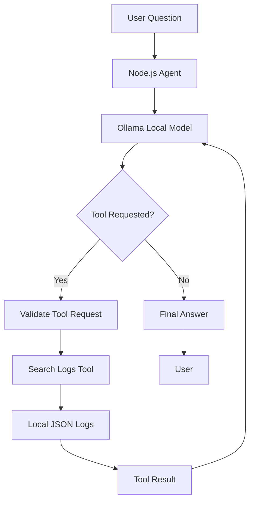

# Local AI Troubleshooting Agent

A beginner-friendly AI agent built with JavaScript, Node.js, and Ollama that investigates synthetic application logs using local tools.

Learn how AI agents work by building one yourself—from connecting a local language model to implementing tool calling, an agent loop, and basic guardrails.

> **Project status:** Learning project / Work in progress

## Table of Contents

- [Overview](#overview)
- [Features](#features)
- [How It Works](#how-it-works)
- [Technology Stack](#technology-stack)
- [Prerequisites](#prerequisites)
- [Getting Started](#getting-started)
- [Project Structure](#project-structure)
- [Example Usage](#example-usage)
- [How Tool Calling Works](#how-tool-calling-works)
- [Testing](#testing)
- [Security and Limitations](#security-and-limitations)
- [Roadmap](#roadmap)
- [Learning Resources](#learning-resources)
- [Contributing](#contributing)
- [License](#license)

## Overview

When an application starts returning errors, developers often need to inspect logs, identify patterns, and investigate possible causes.

This project demonstrates how a local AI agent can help with that process.

The agent accepts a natural-language troubleshooting question, uses a language model running locally, calls predefined JavaScript tools to inspect sample logs, and generates a response based on the returned evidence.

The project is designed to help developers understand the fundamentals of AI agents without requiring cloud infrastructure, a paid LLM API, or a database server.

### What You'll Learn

- The difference between an LLM, a chatbot, and an AI agent.
- How to run a language model locally with Ollama.
- How to define and implement AI agent tools.
- How tool calling works in an application.
- How an agent loop processes tool results.
- How to add basic validation, iteration limits, and error handling.
- How to test agent components independently.

## Features

- **Local inference:** Run a language model using Ollama.
- **Natural-language troubleshooting:** Ask questions about application logs.
- **Tool calling:** Let the model request predefined functions.
- **Log filtering:** Search logs by service, severity, or message text.
- **Evidence-based responses:** Use retrieved log entries to inform the answer.
- **Basic guardrails:** Restrict available tools and bound execution.
- **Automated tests:** Verify log-search behaviour and input validation.
- **No cloud dependency:** Work with synthetic logs stored locally.

## How It Works

The application follows this workflow:

1. The user submits a troubleshooting question.
2. The application sends the conversation and tool definitions to Ollama.
3. The model either responds directly or requests a tool.
4. Node.js validates the request and executes the registered function.
5. The tool result is added to the conversation.
6. The model uses the result to continue its investigation.
7. The application returns the final answer or stops at its configured iteration limit.

### Architecture



The model proposes tool calls; the Node.js application controls which functions are actually executed.

## Technology Stack

| Technology | Purpose |
|---|---|
| JavaScript | Application and agent logic |
| Node.js | JavaScript runtime |
| Ollama | Local model execution |
| Ollama JavaScript library | Communicate with the local model |
| JSON | Sample application log storage |
| Node.js test runner | Automated tests |

## Prerequisites

Before starting, install:

- [Node.js](https://nodejs.org/) — Node.js 20 or newer.
- [Ollama](https://ollama.com/download) — local model runtime.
- A locally available model that supports tool calling.
- A terminal and code editor.

The model's hardware requirements depend on its size and your machine.

## Getting Started

### 1. Clone the repository

```bash
git clone <YOUR_GITHUB_REPOSITORY_URL>
cd local-ai-agent
```

Replace the placeholder with the actual repository URL after publishing.

### 2. Install dependencies

```bash
npm install
```

### 3. Download the model

The initial implementation uses Qwen3 4B as a candidate model.

```bash
ollama pull qwen3:4b
```

Confirm that it is installed:

```bash
ollama list
```

If you use a different model, update the model name in `src/model.js` and verify its tool-calling support.

### 4. Run the application

Ensure Ollama is running, then execute:

```bash
npm start
```

Enter a troubleshooting question when prompted.

Type `exit` to stop the application.

## Project Structure

```text
local-ai-agent/
├── src/
│   ├── index.js
│   ├── agent.js
│   ├── model.js
│   └── tools/
│       └── logs.js
├── data/
│   └── application-logs.json
├── tests/
│   └── logs.test.js
├── package.json
├── package-lock.json
├── .gitignore
└── README.md
```

### Key Components

- `src/index.js` — command-line interface.
- `src/agent.js` — tool definitions, tool execution, and the agent loop.
- `src/model.js` — communication with Ollama.
- `src/tools/logs.js` — log-search implementation and validation.
- `data/application-logs.json` — synthetic application logs.
- `tests/logs.test.js` — automated tests for log searching.

## Example Usage

Start the application:

```bash
npm start
```

Example question:

```text
Investigate the HTTP 500 errors in the payment service.
What evidence is available, and what should I investigate next?
```

The agent should search the available logs and summarise the relevant evidence.

Example output, for illustration:

```text
The payment service has several recorded errors.

Some entries report database connection timeouts,
while another reports a connection refusal.

These entries suggest a possible database connectivity
issue, but the sample logs alone do not establish
the root cause.
```

Actual output will vary with the model and the tool calls it chooses to make.

## How Tool Calling Works

The project exposes a `searchLogs` function to the model.

The model can request structured arguments, such as a service name and severity. The application validates the arguments, invokes the JavaScript function, and returns the result to the model.

The agent loop repeats this process until the model returns an answer or the iteration limit is reached.

This demonstrates an important principle: **tool calling is not the same as giving a model unrestricted access to your computer.** The application decides which tools are available and executes them.

## Testing

Run the automated tests:

```bash
npm test
```

The initial test suite covers:

- Filtering logs by service and severity.
- Searching log messages.
- Handling empty results.
- Rejecting unsupported filter fields.
- Rejecting invalid severity values.
- Enforcing result limits.

Run the tests before and after changing the tool implementation.

## Security and Limitations

This is an educational prototype, not a production-ready incident response system.

Current limitations include:

- Uses synthetic logs rather than live infrastructure telemetry.
- Does not confirm root causes from incomplete evidence.
- Depends on the selected model's tool-calling behaviour.
- Implements only a small set of read-only tools.
- Does not perform remediation or modify infrastructure.
- Has basic guardrails that require further security testing.

Treat log content as untrusted input. Do not expose unrestricted shell execution, arbitrary code execution, sensitive logs, or production credentials to the agent.

## Roadmap

- [ ] Complete the first working local agent.
- [ ] Add automated tests for agent-loop behaviour.
- [ ] Improve model and tool-call error handling.
- [ ] Add a deterministic error-summary tool.
- [ ] Test prompt-injection attempts in sample logs.
- [ ] Add structured investigation traces.
- [ ] Add a simple web interface.
- [ ] Document a reproducible end-to-end investigation.

Items should be marked complete only when the corresponding implementation and tests exist.

## Learning Resources

- [Ollama documentation](https://docs.ollama.com/)
- [Ollama tool calling](https://docs.ollama.com/capabilities/tool-calling)
- [Ollama JavaScript library](https://github.com/ollama/ollama-js)
- [Node.js documentation](https://nodejs.org/docs/latest/api/)
- [Node.js test runner](https://nodejs.org/api/test.html)

## Contributing

Suggestions, bug reports, and improvements are welcome.

If you experiment with a different model or add a new tool, document the setup requirements and include tests where practical.

## License

# Local AI Troubleshooting Agent

A beginner-friendly AI agent built with JavaScript, Node.js, and Ollama that investigates synthetic application logs using local tools.

Learn how AI agents work by building one yourself—from connecting a local language model to implementing tool calling, an agent loop, and basic guardrails.

> **Project status:** Learning project / Work in progress

## Table of Contents

- [Overview](#overview)
- [Features](#features)
- [How It Works](#how-it-works)
- [Technology Stack](#technology-stack)
- [Prerequisites](#prerequisites)
- [Getting Started](#getting-started)
- [Project Structure](#project-structure)
- [Example Usage](#example-usage)
- [How Tool Calling Works](#how-tool-calling-works)
- [Testing](#testing)
- [Security and Limitations](#security-and-limitations)
- [Roadmap](#roadmap)
- [Learning Resources](#learning-resources)
- [Contributing](#contributing)
- [License](#license)

## Overview

When an application starts returning errors, developers often need to inspect logs, identify patterns, and investigate possible causes.

This project demonstrates how a local AI agent can help with that process.

The agent accepts a natural-language troubleshooting question, uses a language model running locally, calls predefined JavaScript tools to inspect sample logs, and generates a response based on the returned evidence.

The project is designed to help developers understand the fundamentals of AI agents without requiring cloud infrastructure, a paid LLM API, or a database server.

### What You'll Learn

- The difference between an LLM, a chatbot, and an AI agent.
- How to run a language model locally with Ollama.
- How to define and implement AI agent tools.
- How tool calling works in an application.
- How an agent loop processes tool results.
- How to add basic validation, iteration limits, and error handling.
- How to test agent components independently.

## Features

- **Local inference:** Run a language model using Ollama.
- **Natural-language troubleshooting:** Ask questions about application logs.
- **Tool calling:** Let the model request predefined functions.
- **Log filtering:** Search logs by service, severity, or message text.
- **Evidence-based responses:** Use retrieved log entries to inform the answer.
- **Basic guardrails:** Restrict available tools and bound execution.
- **Automated tests:** Verify log-search behaviour and input validation.
- **No cloud dependency:** Work with synthetic logs stored locally.

## How It Works

The application follows this workflow:

1. The user submits a troubleshooting question.
2. The application sends the conversation and tool definitions to Ollama.
3. The model either responds directly or requests a tool.
4. Node.js validates the request and executes the registered function.
5. The tool result is added to the conversation.
6. The model uses the result to continue its investigation.
7. The application returns the final answer or stops at its configured iteration limit.

### Architecture


The model proposes tool calls; the Node.js application controls which functions are actually executed.

## Technology Stack

| Technology | Purpose |
|---|---|
| JavaScript | Application and agent logic |
| Node.js | JavaScript runtime |
| Ollama | Local model execution |
| Ollama JavaScript library | Communicate with the local model |
| JSON | Sample application log storage |
| Node.js test runner | Automated tests |

## Prerequisites

Before starting, install:

- [Node.js](https://nodejs.org/) — Node.js 20 or newer.
- [Ollama](https://ollama.com/download) — local model runtime.
- A locally available model that supports tool calling.
- A terminal and code editor.

The model's hardware requirements depend on its size and your machine.

## Getting Started

### 1. Clone the repository

```bash
git clone <YOUR_GITHUB_REPOSITORY_URL>
cd local-ai-agent
```

Replace the placeholder with the actual repository URL after publishing.

### 2. Install dependencies

```bash
npm install
```

### 3. Download the model

The initial implementation uses Qwen3 4B as a candidate model.

```bash
ollama pull qwen3:4b
```

Confirm that it is installed:

```bash
ollama list
```

If you use a different model, update the model name in `src/model.js` and verify its tool-calling support.

### 4. Run the application

Ensure Ollama is running, then execute:

```bash
npm start
```

Enter a troubleshooting question when prompted.

Type `exit` to stop the application.

## Project Structure

```text
local-ai-agent/
├── src/
│   ├── index.js
│   ├── agent.js
│   ├── model.js
│   └── tools/
│       └── logs.js
├── data/
│   └── application-logs.json
├── tests/
│   └── logs.test.js
├── package.json
├── package-lock.json
├── .gitignore
└── README.md
```

### Key Components

- `src/index.js` — command-line interface.
- `src/agent.js` — tool definitions, tool execution, and the agent loop.
- `src/model.js` — communication with Ollama.
- `src/tools/logs.js` — log-search implementation and validation.
- `data/application-logs.json` — synthetic application logs.
- `tests/logs.test.js` — automated tests for log searching.

## Example Usage

Start the application:

```bash
npm start
```

Example question:

```text
Investigate the HTTP 500 errors in the payment service.
What evidence is available, and what should I investigate next?
```

The agent should search the available logs and summarise the relevant evidence.

Example output, for illustration:

```text
The payment service has several recorded errors.

Some entries report database connection timeouts,
while another reports a connection refusal.

These entries suggest a possible database connectivity
issue, but the sample logs alone do not establish
the root cause.
```

Actual output will vary with the model and the tool calls it chooses to make.

## How Tool Calling Works

The project exposes a `searchLogs` function to the model.

The model can request structured arguments, such as a service name and severity. The application validates the arguments, invokes the JavaScript function, and returns the result to the model.

The agent loop repeats this process until the model returns an answer or the iteration limit is reached.

This demonstrates an important principle: **tool calling is not the same as giving a model unrestricted access to your computer.** The application decides which tools are available and executes them.

## Testing

Run the automated tests:

```bash
npm test
```

The initial test suite covers:

- Filtering logs by service and severity.
- Searching log messages.
- Handling empty results.
- Rejecting unsupported filter fields.
- Rejecting invalid severity values.
- Enforcing result limits.

Run the tests before and after changing the tool implementation.

## Security and Limitations

This is an educational prototype, not a production-ready incident response system.

Current limitations include:

- Uses synthetic logs rather than live infrastructure telemetry.
- Does not confirm root causes from incomplete evidence.
- Depends on the selected model's tool-calling behaviour.
- Implements only a small set of read-only tools.
- Does not perform remediation or modify infrastructure.
- Has basic guardrails that require further security testing.

Treat log content as untrusted input. Do not expose unrestricted shell execution, arbitrary code execution, sensitive logs, or production credentials to the agent.

## Roadmap

- [ ] Complete the first working local agent.
- [ ] Add automated tests for agent-loop behaviour.
- [ ] Improve model and tool-call error handling.
- [ ] Add a deterministic error-summary tool.
- [ ] Test prompt-injection attempts in sample logs.
- [ ] Add structured investigation traces.
- [ ] Add a simple web interface.
- [ ] Document a reproducible end-to-end investigation.

Items should be marked complete only when the corresponding implementation and tests exist.

## Learning Resources

- [Ollama documentation](https://docs.ollama.com/)
- [Ollama tool calling](https://docs.ollama.com/capabilities/tool-calling)
- [Ollama JavaScript library](https://github.com/ollama/ollama-js)
- [Node.js documentation](https://nodejs.org/docs/latest/api/)
- [Node.js test runner](https://nodejs.org/api/test.html)

## Contributing

Suggestions, bug reports, and improvements are welcome.

If you experiment with a different model or add a new tool, document the setup requirements and include tests where practical.

## License

This project is licensed under the [MIT License](LICENSE).

You are free to use, copy, modify, merge, publish, distribute, sublicense, and sell copies of this software, subject to the terms of the MIT License.

